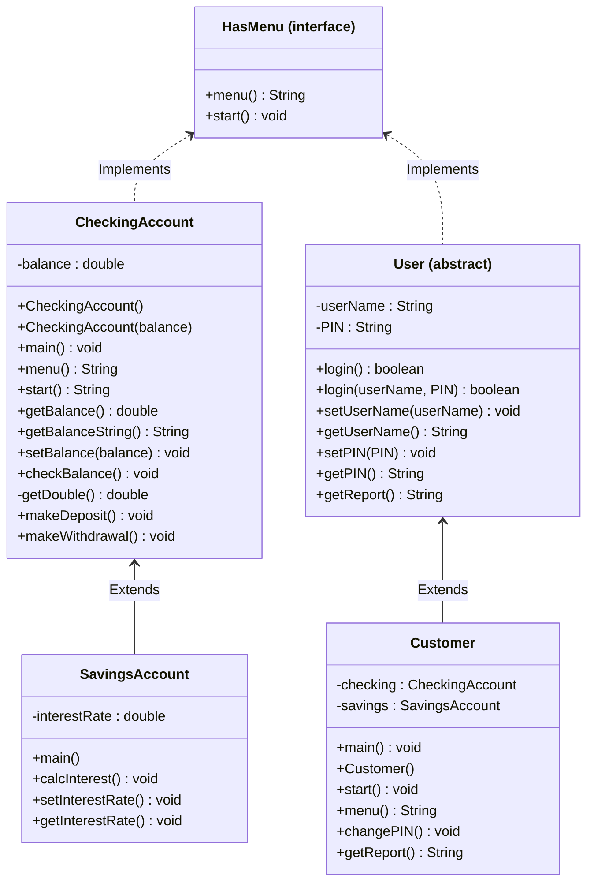

# CS121-Bank-on-it-part-I-Project
## UML class Diagram 

```
## HasMenu

```text
HasMenu
    - create interface HasMenu
    - String menu()
    - void start()
```

## CheckingAccount

```text
main()
    - create new CheckingAccount object
        - new CheckingAccount()
    - account.start()

CheckingAccount()
    - balance = 0

CheckingAccount(double balance)
    - this.balance = balance

getBalance()
    - return balance

getBalanceString()
    - return String.format("$%.2f", balance)

setBalance(double balance)
    - this.balance = balance

checkBalance()
    - print "Current balance: " + getBalanceString()

getDouble()
    - return input.nextDouble()

makeDeposit()
    - print "Making a deposit..."
    - print "How much to deposit?"
    - amount = getDouble()

    - if amount > 0
        - balance = balance + amount
    - else
        - print "Invalid amount"

    - print "New balance: " + getBalanceString()

makeWithdrawal()
    - print "Making a withdrawal..."
    - print "How much to withdraw?"
    - amount = getDouble()

    - if amount > 0 && amount <= balance
        - balance = balance - amount
    - else
        - print "Invalid amount or not enough money"

    - print "New balance: " + getBalanceString()

menu()
    - print "Account menu"
        - 0) quit
        - 1) check balance
        - 2) make a deposit
        - 3) make a withdrawal
    - print "Please enter 0-3:"
    - return input.next()

start()
    - choice = ""

    - while !choice.equals("0")
        - choice = menu()

        - if choice.equals("1")
            - checkBalance()
        - else if choice.equals("2")
            - makeDeposit()
        - else if choice.equals("3")
            - makeWithdrawal()
        - else if !choice.equals("0")
            - print "Invalid choice"
```

## SavingsAccount

```text
main()
    - create new SavingsAccount object
        - new SavingsAccount()
    - account.start()

SavingsAccount()
    - interestRate = 0

calcInterest()
    - interest = getBalance() * interestRate
    - setBalance(getBalance() + interest)

setInterestRate(double interestRate)
    - this.interestRate = interestRate

getInterestRate()
    - return interestRate
```

## User

```text
User()
    - userName = ""
    - PIN = ""

login()
    - print "User name:"
    - name = input.next()
    - print "PIN:"
    - pin = input.next()
    - return login(name, pin)

login(String userName, String PIN)
    - if this.userName.equals(userName) &&
         this.PIN.equals(PIN)
        - return true
    - else
        - return false

setUserName(String userName)
    - this.userName = userName

getUserName()
    - return userName

setPIN(String PIN)
    - this.PIN = PIN

getPIN()
    - return PIN

getReport()
    - abstract String method
    - implemented in Customer
```

## Customer

```text
main()
    - create new Customer object
        - new Customer()

Customer()
    - checking = new CheckingAccount()
    - savings = new SavingsAccount()
    - setUserName("admin")
    - setPIN("0000")

    - if login() == true
        - print "Login Successful"
        - start()
    - else
        - print "Login Failed"

Customer(String userName, String PIN)
    - checking = new CheckingAccount()
    - savings = new SavingsAccount()
    - setUserName(userName)
    - setPIN(PIN)

menu()
    - print "Customer Menu"
        - 0) Exit
        - 1) Manage Checking Account
        - 2) Manage Savings Account
        - 3) Change PIN
    - print "Action (0-3):"
    - return input.next()

start()
    - choice = ""

    - while !choice.equals("0")
        - choice = menu()

        - if choice.equals("1")
            - print "Checking Account"
            - checking.start()
        - else if choice.equals("2")
            - print "Savings Account"
            - savings.start()
        - else if choice.equals("3")
            - changePIN()
        - else if choice.equals("0")
            - print "Goodbye!"
        - else
            - print "Invalid choice"

changePIN()
    - print "Enter new PIN:"
    - newPIN = input.next()
    - setPIN(newPIN)
    - print "PIN changed successfully"

getReport()
    - report = "Customer: " + getUserName()
    - report = report + "\nChecking: " + checking.getBalanceString()
    - report = report + "\nSavings: " + savings.getBalanceString()
    - return report
```


